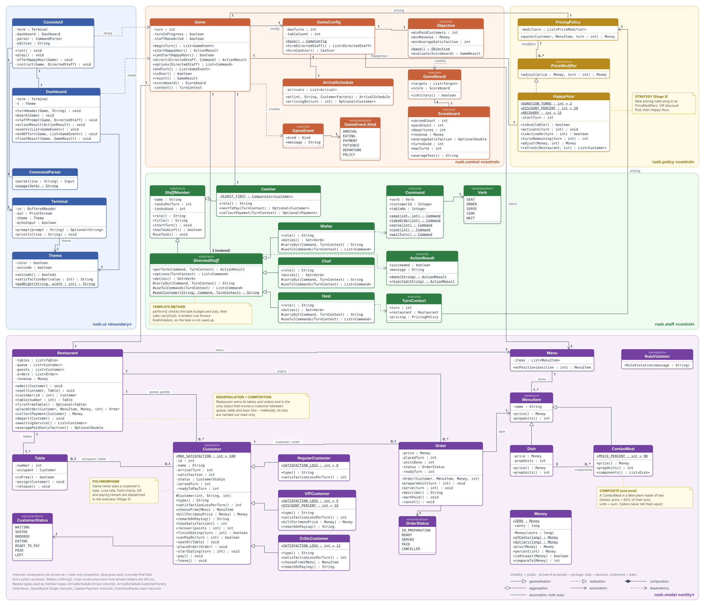

# Restaurant Rush

A turn-based restaurant management game for the command line, built in Java in three
tagged stages for the SC2002 group assignment. You are the manager: every turn you
decide what the Host, Waiter and Chef do, and the Cashier collects payment on their own.
Staff time is scarce, so the real decision is always *who comes first*.

| | |
|---|---|
| **Repository** | `https://github.com/[ORG]/restaurant-rush` ← *replace with your URL* |
| **Group** | `[LAB GROUP] · Group [N]` ← *fill in* |
| **Report** | [`docs/report/Restaurant-Rush-Report.pdf`](docs/report/Restaurant-Rush-Report.pdf) |
| **Video** | `[link or file name]`, timestamps [below](#video-timestamps) |

```
   ╦═╗┌─┐┌─┐┌┬┐┌─┐┬ ┬┬─┐┌─┐┌┐┌┌┬┐  ╦═╗┬ ┬┌─┐┬ ┬
   ╠╦╝├┤ └─┐ │ ├─┤│ │├┬┘├─┤│││ │   ╠╦╝│ │└─┐├─┤
   ╩╚═└─┘└─┘ ┴ ┴ ┴└─┘┴└─┴ ┴┘└┘ ┴   ╩╚═└─┘└─┘┴ ┴
```

---

## Build and run

You need only a JDK, version 17 or newer. There is no build tool to install and no network access is used.

```bash
./run.sh                                         # build and play
./run.sh --script scripts/stage3-victory.txt     # replay a recorded run
./run.sh --plain                                 # no colour, ASCII only (old terminals)
./test.sh                                        # 22 rule checks
```

On Windows, use `run.bat` and `test.bat` (add `--plain` if the console shows odd symbols).
Without the scripts:

```bash
javac --release 17 -d out $(find src -name '*.java')
java -cp out rush.Main
```

To play an earlier stage, check out its tag and run it in the same way:

```bash
git checkout stage-1
./run.sh --script scripts/stage1-victory.txt
git checkout main
```

## How to play

Each turn shows the dashboard: turn, revenue, paid customers, average satisfaction, the
queue, both tables with satisfaction bars, the kitchen, and the commands each member of
staff can use right now. Then you give each staff member one instruction.

| Command | Who | Meaning |
|---|---|---|
| `seat <customer> [table]` | Host, Waiter | seat a queued customer (default: first free table) |
| `order <customer>` | Waiter | take a seated customer's order (they choose the food) |
| `serve <customer>` | Waiter | serve that customer's READY dish |
| `cook <customer>` | Chef | one preparation unit on that customer's order |
| `wait` | anyone | do nothing this turn |
| `board`, `menu`, `help`, `quit` | — | redraw, show the menu, help, leave |

Short forms are `s 2 1`, `o 2`, `v 2`, `c 2` and `w`. An invalid instruction explains why it
failed and does not use up the task.

**Win** after turn 18 with at least 4 paid customers, revenue of at least $45.00, and an
average satisfaction of paid customers of at least 60.

## Design at a glance

```
rush.ui       ConsoleUI · Dashboard · CommandParser · Terminal · Theme     (boundary: no rules)
rush.control  Game · GameConfig · ArrivalSchedule · Objective · Scoreboard (turn sequence)
rush.staff    StaffMember ◁ DirectedStaff ◁ Waiter, Chef, Host · Cashier   (what each role may do)
rush.policy   PricingPolicy · PriceModifier ◁ HappyHour                    (pricing rules)
rush.model    Restaurant · Table · Customer ◁ Regular/VIP/Critic · Order · MenuItem ◁ Dish/ComboMeal · Money
```

* **Polymorphism**: customer types differ only in `satisfactionLossPerTurn()`,
  `chooseFrom(Menu)` and `billFor(Money)`. The turn controller never checks a type.
* **Template method**: `DirectedStaff.perform()` checks the task budget and the role's
  duties, then calls `carryOut()`. A broken rule throws `RuleViolation` and costs nothing.
* **Composite**: a `ComboMeal` is a `MenuItem` made of two `Dish`es (90% of their price, summed units).
* **Encapsulation**: money is integer cents; only `Restaurant` moves customers between the
  queue, a table and the door.



Sequence diagram (a VIP order during Happy Hour, from arrival to payment):
[part A](docs/diagrams/sequence-1-arrival-order.svg) ·
[part B](docs/diagrams/sequence-2-service-payment.svg) (sources in `docs/diagrams/*.mmd`).

## Stages and change analysis

| Tag | Adds | Rule checks |
|---|---|:-:|
| `stage-1` | Regular customers, menu, Waiter, Chef, Cashier, full turn sequence, both endings | 12 |
| `stage-2` | `VIPCustomer` (−5/turn, 10% off), `CriticCustomer` (−12/turn, orders the most elaborate dish) | 16 |
| `stage-3` | `Host`, `ComboMeal`, Happy Hour | 22 |

Every tag compiles on its own, passes its own checks, and replays its own victory and defeat
scripts.

### Stage 1 → Stage 2

Compare: `https://github.com/[ORG]/restaurant-rush/compare/stage-1...stage-2`
(locally: `git diff stage-1 stage-2 --stat`), commit `a721c2d`.

| File | Change | Why |
|---|---|---|
| `src/rush/model/VIPCustomer.java` | **new** | Loses 5 per turn; `billFor` gives 10% off |
| `src/rush/model/CriticCustomer.java` | **new** | Loses 12 per turn; overrides `chooseFrom` to order the most elaborate dish; star review on payment |
| `src/rush/model/Money.java` | +5 lines | `percent(int)` rounding half-up, first needed for the VIP discount |
| `src/rush/control/GameConfig.java` | 2 lines | Registration: arrival #2 becomes a Critic and #3 a VIP (still six arrivals) |
| `src/rush/ui/Dashboard.java` | small | Colour per customer type and a guest-type legend (presentation only) |
| `src/rush/Main.java` | 1 line | Edition label |
| `test/rush/RulesTest.java`, `scripts/stage2-*`, docs | updated | New rule checks, Stage 2 runs |
| `Game`, `Customer`, `Restaurant`, `Order`, all staff | **unchanged** | New behaviour is dispatched through the new subclasses |

### Stage 2 → Stage 3

Compare: `https://github.com/[ORG]/restaurant-rush/compare/stage-2...stage-3`
(locally: `git diff stage-2 stage-3 --stat`), commit `13d6dc5`.

| File | Change | Why |
|---|---|---|
| `src/rush/staff/Host.java` | **new** | `DirectedStaff` whose only duty is `SEAT`; reuses the shared seating helper |
| `src/rush/model/Dish.java` | **new** | The concrete dish class extracted from `MenuItem` |
| `src/rush/model/ComboMeal.java` | **new** | Two dishes: 90% of the combined price, summed units |
| `src/rush/model/MenuItem.java` | **rewritten** | Concrete class → abstract (`price()`, `prepUnits()`). Its public API is unchanged, so `Order`, `Chef`, `Waiter` and the Critic need no edits |
| `src/rush/policy/PriceModifier.java`, `HappyHour.java` | **new** | Once per game, two turns, 20% off orders taken, +15 recovery for guests still waiting |
| `src/rush/policy/PricingPolicy.java` | changed | Applies `PriceModifier`s after the customer's own discount (VIP first, then Happy Hour) |
| `src/rush/model/Customer.java` | +14 lines | `recover(points)` for Happy Hour (capped at 100) |
| `src/rush/control/Game.java` | changed | Owns Happy Hour; `startHappyHour()` only before any staff acts; recovery at turn start |
| `src/rush/control/GameConfig.java` | small | Registration: menu with two combos; Host hired first |
| `src/rush/control/GameEvent.java` | 1 line | `POLICY` event kind |
| `src/rush/ui/ConsoleUI.java`, `Dashboard.java` | changed | Happy Hour prompt and remaining-duration display; staff with nothing to do wait automatically |
| `Waiter`, `Chef`, `Cashier`, `DirectedStaff`, `Restaurant`, `Order` | **unchanged** | The Host and combos fit the existing abstractions |

## Reproducible runs

| Script | Result |
|---|---|
| `scripts/stage1-victory.txt` | **Victory**: 5 paid, $66.00, average 79.2 (includes two rejected inputs) |
| `scripts/stage1-defeat.txt` | **Defeat**: 3 paid, $42.00 |
| `scripts/stage2-victory.txt` | **Victory**: 5 paid, $67.20, average 76.0 (VIP pays $16.20; Critic orders Pasta) |
| `scripts/stage2-defeat.txt` | **Defeat**: 3 paid, $43.20, average 59.3 |
| `scripts/stage3-victory.txt` | **Victory**: 5 paid, $92.16, average 82.6 (Happy Hour on turn 7; VIP Pasta $12.96) |
| `scripts/stage3-defeat.txt` | **Defeat**: 3 paid, $49.50, average 57.0 |

Each script belongs to its own tag. Turn-by-turn notes, and a table showing how different
manager strategies change the result, are in [`docs/TEST_NOTES.md`](docs/TEST_NOTES.md). Full
transcripts are in [`docs/transcripts/`](docs/transcripts/).

## Video timestamps

Fill these in after recording (script: [`docs/VIDEO_SCRIPT.md`](docs/VIDEO_SCRIPT.md)).

| # | Segment | Presenter | Start |
|:-:|---|---|---|
| 1 | The game launching from the submitted project | `[name]` | `00:00` |
| 2 | Meaningful manager choices, including a constrained decision | `[name]` | `[mm:ss]` |
| 3 | A dish going READY → SERVED → payment | `[name]` | `[mm:ss]` |
| 4 | VIP and Critic behaviour | `[name]` | `[mm:ss]` |
| 5 | Stage 3 features: Host, combo, Happy Hour | `[name]` | `[mm:ss]` |
| 6 | One victory and one defeat | `[name]` | `[mm:ss]` |
| 7 | Stage tag comparisons and the diagrams | `[name]` | `[mm:ss]` |

## Repository layout

```
src/rush/            game source (ui, control, staff, policy, model)
test/rush/           rule checks (plain Java, run with ./test.sh)
scripts/             recorded manager inputs for each stage's victory and defeat runs
docs/report/         report source (HTML + CSS), build script, and the PDF
docs/diagrams/       class diagram generator and SVG, sequence diagram sources and SVGs
docs/transcripts/    plain-text transcripts of every scripted run
docs/TEST_NOTES.md   turn-by-turn notes for the reproducible runs
docs/VIDEO_SCRIPT.md plan for the 15-minute video
```

To rebuild the report (needs Google Chrome; Mermaid is fetched from a CDN):

```bash
python3 docs/report/build.py
```

## Submission checklist

- [ ] Replace `[ORG]`, `[LAB GROUP]`, `[N]` and the member names in this README and in `docs/report/report.html`, then rebuild the PDF
- [ ] Push the branch **and the tags**: `git push -u origin main --tags`
- [ ] Record the video, then fill in the timestamps above
- [ ] Each member signs the Declaration of Original Work and the Declaration on Use of GAI Assistance
- [ ] Zip the source, README, PDF report, video (or link) and declarations as `LABGroup_AssignmentGrp.zip`
